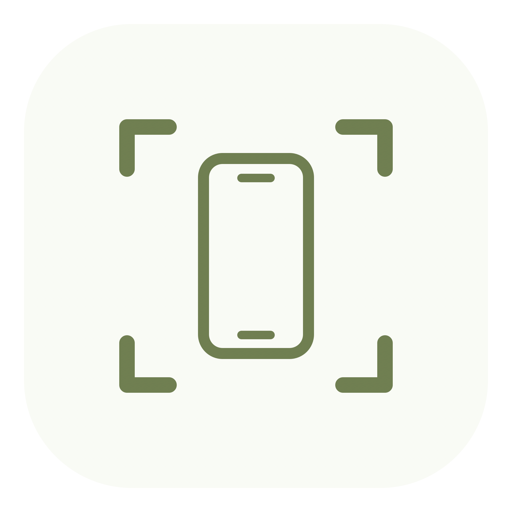

<p align="center">
  
</p>

<h1 align="center">Tauross</h1>
<p align="center">Your phone, on your Mac.</p>
<p align="center">
  <a href="https://github.com/Duy-Company/tauross/releases/latest">Download</a> ·
  <a href="https://github.com/Duy-Company/tauross/issues">Report an issue</a>
</p>

Tauross is a lightweight macOS app for mirroring Android devices and viewing USB-connected iPhone/iPad screens. It has a compact, English-only interface with a white background and moss green accents.

## Features

- **Android over USB or Wi-Fi** — connect authorized devices, pair using Android 11+ Wireless debugging, or use a running Android emulator.
- **Android control** — click, drag, scroll, and type from your Mac. Back, Home, and Recent Apps are also available in the Device menu.
- **Stream settings** — choose resolution, frame rate, and video bitrate; enable input control and stay-awake.
- **iPhone and iPad over USB** — view-only capture using macOS CoreMediaIO and AVFoundation. Physical-device validation is still pending.
- **Separate mirror window** — resize by dragging its edges, keep the correct video aspect ratio, and use the standard macOS window controls.
- **Multiple devices at once** — each device has its own macOS window, toolbar, input, screenshots, and recording. Mirror windows remain separate even when macOS is set to always open windows as tabs; each has native close, minimize, and zoom controls and its own entry in the app's window list. Clicking Mirror again brings that device's existing window forward, including when minimized. Closing or disconnecting one device leaves the others running.
- **PNG screenshots** — save the current device screen with **⌘S**.
- **Mirror tools** — a companion toolbar sits outside the mirror window, with Android power, volume, navigation, rotation, and notifications; both platforms have screenshot and recording buttons.
- **Video recording** — save H.264 or HEVC video in MP4 or MOV, with separate resolution, frame rate, and bitrate settings for Android and iOS. Android shares one capture between mirroring and recording, at the higher quality requested by either output.
- **Local capture folder** — screenshots and recordings are automatically saved in `~/.tauross/screenshots` and `~/.tauross/recordings`. Open the folder from Settings or the Device menu.
- **In-app updates** — check for updates from the Tauross menu, with signed update feeds and downloads powered by Sparkle.
- **Everything included** — ADB, scrcpy-server, and Sparkle are bundled in the app. No Homebrew or separate command-line tools are needed.

## Install

Requires **macOS 14 or later**, on **Apple Silicon or Intel**.

1. Download the universal `.dmg` or `.zip` from [Releases](https://github.com/Duy-Company/tauross/releases/latest).
2. Copy **Tauross.app** to **Applications** before opening it.
3. Select a device and click **Mirror**.

The initial release is ad hoc signed and is not Apple notarized. Sparkle's dedicated Ed25519 signatures protect update feeds and archives; these are separate from Apple's Developer ID signing.

## Connect a device

### Android

Enable **Developer options → USB debugging**, connect a data-capable USB cable, unlock your phone, and accept **Allow USB debugging**. Authorized Android emulators appear in the same device list.

For Wi-Fi, use **Tauross → Settings… → Android → Connect over Wi-Fi…**. On Android 11+, pair with the six-digit code from **Wireless debugging → Pair device with pairing code**, then connect with the IP address and **connection port** from the main Wireless debugging screen. The pairing and connection ports are different. Your phone and Mac need a reachable shared network.

### iPhone / iPad

Connect with a data-capable USB cable, unlock the device, and choose **Trust This Computer**. Allow Tauross access to **Camera** when macOS asks: the iOS screen is exposed as a capture source. Close QuickTime if it is using that source.

## Controls

| Action | Control |
|---|---|
| Mirror a device | Select it, then click **Mirror** |
| Android touch / swipe / scroll | Click / drag / scroll in the mirror window |
| Android Back | Esc or right-click |
| Stream settings | **⌘,** |
| Refresh devices | **⌘R** |
| Save screenshot | **⌘S** |
| Start / stop recording | **⇧⌘R** |
| Recording quality and format | **⌘,** → Android or iOS → **Video Recording** |
| Stop mirroring | Close the mirror window or **⌘.** |
| Stop every mirror | **Device → Stop All Mirroring** |
| Show device list | **⌘N** |
| Check for updates | **Tauross → Check for Updates…** |

Changes to an active Android stream take effect with **Apply & Restart** in Settings. Applying restarts the named device's mirror and closes Settings. Automatic update checks can be toggled in the Tauross menu; installing an update requires your confirmation.

Device commands and keyboard shortcuts target the focused mirror, or the selected device when using the device list. Settings identifies the device that will be restarted when applying stream changes. Stream defaults apply to newly opened mirrors; existing devices keep their active settings until explicitly restarted. Quitting Tauross finishes every device's active recording before exiting.

Recording settings are saved separately for each platform and apply to the next recording. Android uses a single shared capture and decoder; it briefly reconnects the mirror if capture quality needs to change when recording starts or stops. While recording, the capture resolution, frame rate, and bitrate satisfy the higher stream/recording requirements, while the saved video uses its own output settings. HEVC with a lower bitrate can reduce file size; changing the MP4/MOV container alone does not reduce it. iOS recording quality is limited by the automatic USB capture source. Recordings contain video only. If the device rotates during recording, the new orientation fits inside the initial video dimensions with letterboxing. Closing the mirror or quitting Tauross finishes the recording before exit.

## Current limitations

- One mirror window per device; there is no fixed app limit on the number of devices mirrored simultaneously.
- iOS is USB and view-only; its capture implementation still needs testing with a physical iPhone/iPad.
- Audio forwarding, recording audio, and iOS Wi-Fi are not included.
- Android text input has limitations with complex Unicode and input methods.
- USB debugging / Wireless debugging authorization is required by Android itself.

## Build from source

Requires **Xcode 16 or later** with Swift 6. Open `Tauross.xcodeproj` and select the **Tauross** scheme. Xcode resolves the pinned Sparkle package; end users receive the embedded framework.

```sh
./Scripts/build.sh Release
```

The app is generated at `build/DerivedData/Build/Products/Release/Tauross.app`. Builds include both `arm64` and `x86_64`.

```sh
./Scripts/test.sh
./Scripts/test-updates.sh
python3 -m unittest discover -s Tests -p '*Tests.py'
# Optional: stream test against an authorized device or emulator
TAUROSS_TEST_DEVICE=emulator-5554 ./Scripts/test.sh --filter AndroidIntegrationTests
```

Run `python3 Scripts/generate-project.py` after adding or removing Swift source files. See [UPDATES.md](UPDATES.md) for release and updater configuration, and [DEPENDENCIES.md](DEPENDENCIES.md) for bundled tool versions and third-party licenses.

## Acknowledgments

Android mirroring uses [scrcpy-server](https://github.com/Genymobile/scrcpy) and [ADB](https://android.googlesource.com/platform/packages/modules/adb/), with native VideoToolbox decoding on macOS. Updates use [Sparkle](https://sparkle-project.org/). Third-party license notices are included in the app.
